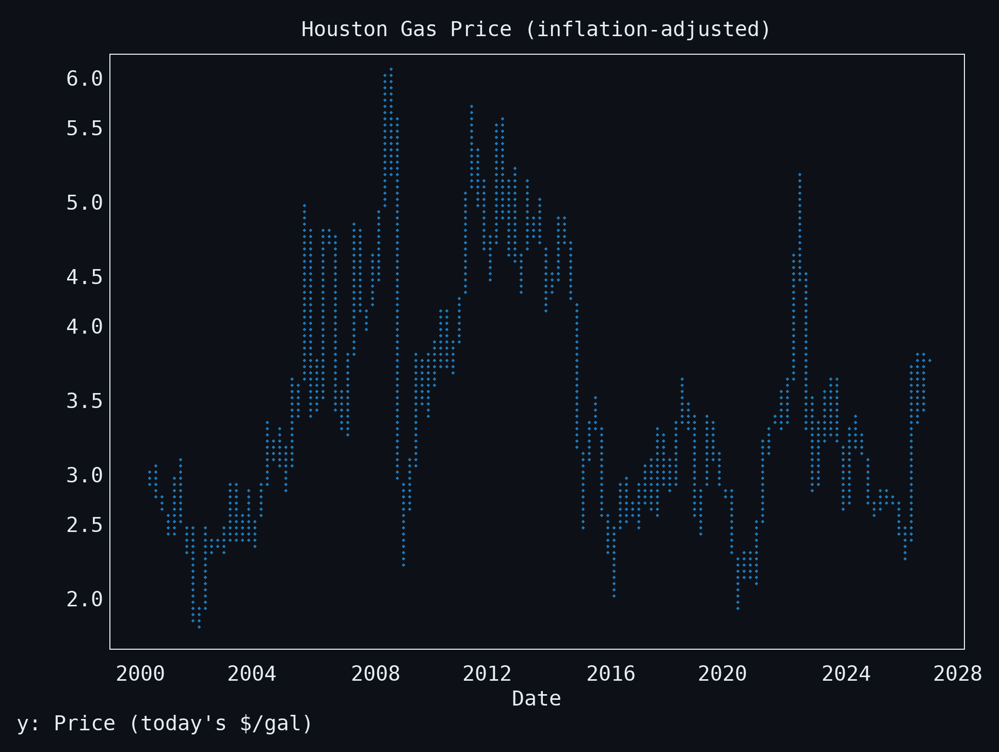
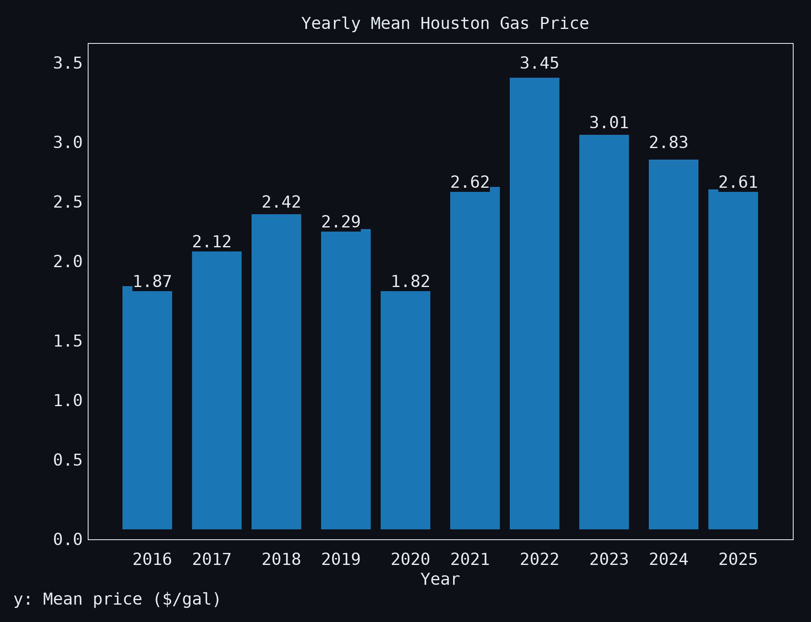
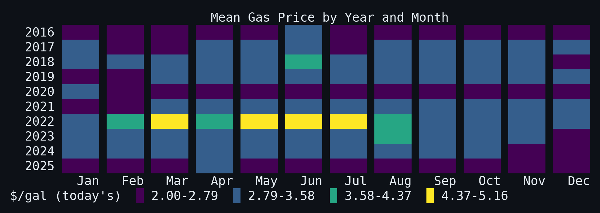
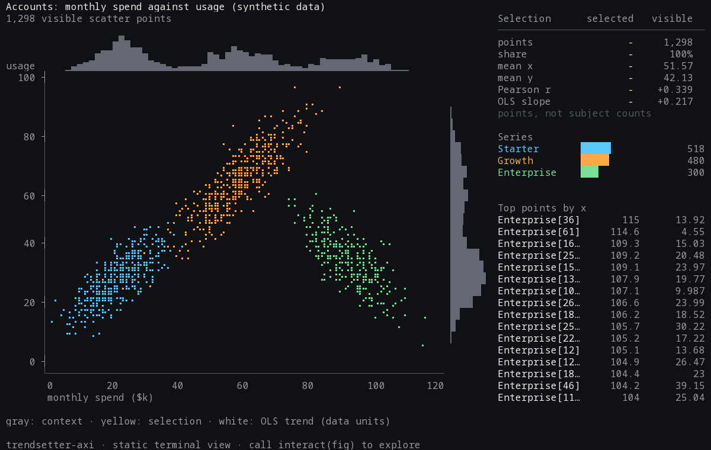
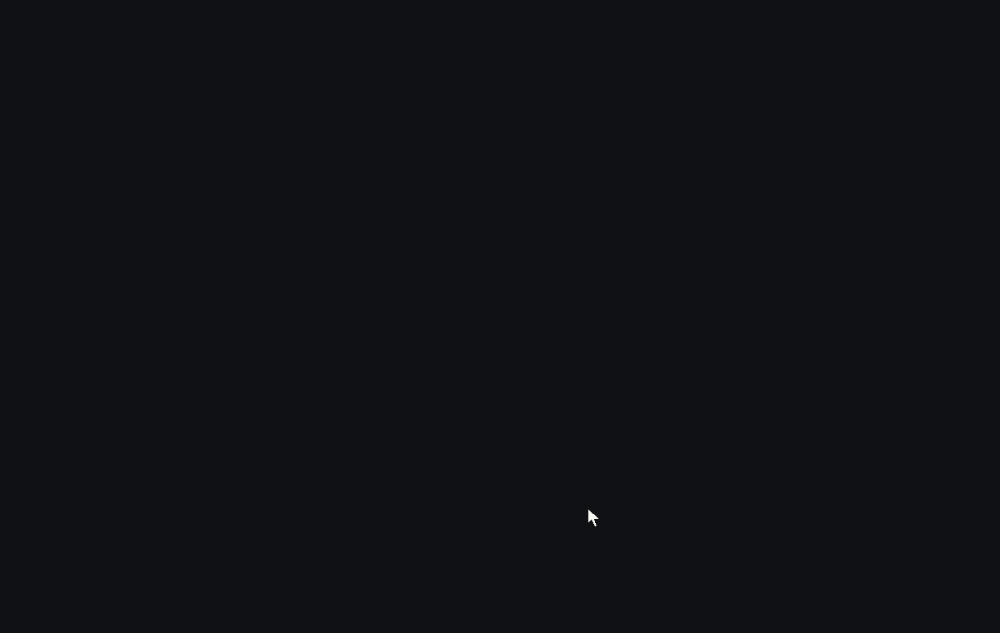
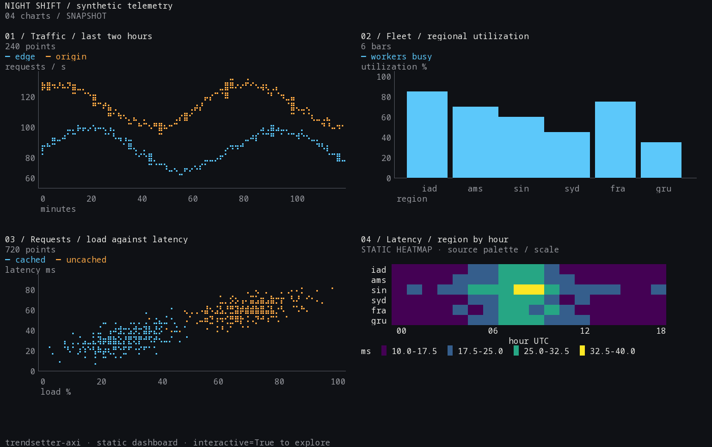
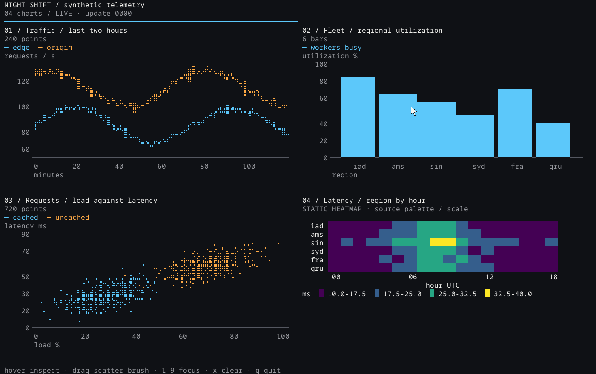

# trendsetter-axi

Terminal charts. trendsetter-axi renders matplotlib figures and SVG as unicode text (braille lines, block bars, shaded heatmaps) that fits a fixed number of columns. Formerly prototyped as "termchart".

## Why

More analysis now happens in a terminal, next to an agent, with no IDE or notebook open. trendsetter-axi takes the matplotlib code you already have and makes one render serve both readers: a chart the person can read where they work, and a compact account of the same figure that an agent can check.

```python
from trendsetter_axi import render

r = render(fig, cols=80, strict=True)   # your existing figure; see the strict-mode contract below
print(r.text)                           # for the person: every line fits 80 cells
context = r.summary()                   # for the agent: scales, series values from the figure's data, what was lost

lean = render(fig, cols=60, rows=12, ascii=True)
hybrid = lean.text + "\n\n" + lean.summary()  # for an agent that should also see the shape: a small ASCII chart, then the numbers
```

- Output size: `render` bounds every line with `cols`; its `rows` remains a preferred height, which heatmaps and bar charts can exceed. The opt-in [`render_compact`](#bounded-displays-and-preferences) also enforces a hard `max_rows`, titles and omissions included. `ascii=True` uses cheaper drawing glyphs; `dimensions` reports cells and lines used.
- Source summaries: eligible source observations, errorbar bounds, axis/tick identity and unsupported-artist coverage, not values reverse-engineered from terminal glyphs. Masked/non-finite line and scatter rows and hidden artists are excluded; missing counts and summary omissions remain explicit. See the [summary contract](#what-the-text-lost-render) for sampling and precision.
- Diagnostics: `r.losses` includes heatmap sampling and per-artist visibility diagnostics. Strict mode rejects material losses, not every approximation. See [loss reporting and strict mode](#what-the-text-lost-render) for painter order, materiality and known limits, and [SVG limits](#svg-limits) for bounded traversal and decoding.

**Record benchmark rerun (2026-11-05):** same 70 charts/questions, three trials on
`claude-sonnet-5-5`, effort low; all 630 cells completed via subscription CLI
([results](benchmarks/agent/RESULTS-suite3.md), [predeclared bars](benchmarks/agent/README-suite3.md)).

| same-day input | correct / 840 answers | total input tokens, three trials |
| --- | ---: | ---: |
| experimental chart record | 828/840 | 648,990 |
| record + optional query CLI | 825/840 | 831,009 |
| direct `table+stats` control | 805/840 | 330,342 |

Both record arms beat the **earlier-run** summary/hybrid below and pass the
same-day control competitiveness bar. Full record access is more accurate here,
not smaller: input is **1.96×** control, or **2.52×** with the query protocol.
Records retain full eligible arrays; control tables are sampled, so this does
not show an advantage over full-source tables. Query access adds no observed
accuracy gain: 27 CLI requests across 22/210 cells, with replay input counted in
full. This bounded JSON tool protocol is not a native-tool integration. Charts
are reused, not a fresh holdout; no general superiority, summary rewrite or
other-library-reader claim follows. Renderer, summary and query code are unchanged.

**Earlier-run suite2 evidence** at renderer `4376145`: 70 charts, three trials on `claude-sonnet-5-5`, seven paired arms ([original results cells](benchmarks/agent/RESULTS.md#pooled-paired-results)).

| input | correct / 840 answers | wrong (non-abstained) | abstained | total input tokens, three trials |
| --- | ---: | ---: | ---: | ---: |
| direct `table+stats` | 797/840 | 10 | 33 | 330,342 |
| `summary()` | 659/840 | 14 | 167 | 252,243 |
| hybrid | 700/840 | 11 | 129 | 305,481 |
| PNG | 756/840 | 59 | 25 | 307,560 |
| terminal text | 380/840 | 156 | 304 | 412,284 |

Summary **failed** the [predeclared criterion](benchmarks/agent/RESULTS.md#predeclared-criterion): 138 fewer correct answers than `table+stats`. Total-input ratio: 76.4%; chart-only input (subtracting paired `none`): **31,623 vs 109,722 tokens, 28.8%**. The ≤40% total-input target was unreachable as written: `none` alone uses 220,620 input tokens, 66.8% of `table+stats`. The frozen criterion and FAIL remain unchanged because the accuracy deficit fails independently.

Summary mostly declines rather than invents: 167 abstentions versus 14 wrong answers. Misses concentrate in point lookups it does not carry, such as scatter y-at-x and heatmap cell queries. Across all questions of those kinds, summary scores [60/120 with 54 abstentions on scatter and 85/120 with 35 abstentions on heatmaps](benchmarks/agent/RESULTS.md#wrong-answers-versus-abstention).

For the human-readable preview and optional hybrid, no claim that either beats direct data or PNG. `summary()` is not a replacement for the source arrays; retain them when correctness matters. The experimental record is a higher-accuracy option on the rerun above, with a larger token cost; it does not change the summary's failed result.

[Historical pilot only](benchmarks/agent/RESULTS.md#historical-pilot-not-rerun-not-comparable), `after` at 9288d2b: summary 79/81 dev and 37/39 held-out; hybrid 78/81 and 39/39; PNG 80/81 and 39/39. Median chart tokens respectively 102/114, 316/326 and 408/408. Those single-model, single-run results had no direct-data baseline and do not validate later renderer changes.

## Install

Requires Python >=3.10, Matplotlib >=3.10.0 and NumPy >=1.23.0 (no upper
version bounds). CI tests Python 3.10, 3.12 and 3.14 with the latest compatible
dependencies, plus Python 3.10 with those exact Matplotlib/NumPy floors. Newer
Python versions need newer NumPy releases; the installer selects compatible wheels.

The project is not currently published on PyPI (`trendsetter-axi` returns 404).
Install directly from GitHub in a virtual environment:

```sh
uv venv .venv
source .venv/bin/activate
uv pip install git+https://github.com/papayuh/trendsetter-axi
```

For an editable source checkout (in an active virtual environment):

```
git clone https://github.com/papayuh/trendsetter-axi
cd trendsetter-axi
uv pip install -e .
```

## Usage

```python
import matplotlib.pyplot as plt
from trendsetter_axi import render_figure

fig, ax = plt.subplots()
ax.plot([1, 2, 3, 4, 5], [2, 4, 3, 5, 7])
ax.set(title="Example", xlabel="x", ylabel="y")

print(render_figure(fig, cols=80))
```

`render_svg(svg_text, cols=80)` does the same for SVG source. For matplotlib SVG, save with `svg.fonttype` set to `"none"` so text stays text. See [SVG limits](#svg-limits) for work and image-decode limits, clipping and unsupported effects.

`render_figure(fig, cols=80, color=False)` and `render_svg(svg_text, cols=80, color=False)` are text-only shortcuts for `render(source, cols=80, color=False).text`: the same chart, without building the report. Both functions take `color=True` for 24-bit ANSI colour. Colour never changes the cell width.

For matplotlib figures, dense black and grey data lines use the same batched dot sampler as coloured lines; short neutral rules keep their box-drawing glyphs. The batching threshold is documented in `Canvas.stroke()` in [`core.py`](src/trendsetter_axi/core.py); it applies only to strokes tagged as data, not unclassified SVG geometry.

### Experimental chart records and queries

`from_figure(fig)` reads a JSON-safe chart record in axis data coordinates without drawing.
`query(record, operation, *args)` computes answers from those arrays, not pixels or
rounded summary strings. This API and record schema are **experimental**. Existing
`render()` output and `summary()` text are unchanged; neither consumes the record yet.

```python
import json
from trendsetter_axi import from_figure, query

record = from_figure(fig)  # matplotlib Figure, including seaborn/pandas figures
print(query(record, "value_at", "m0", 3))  # record-local id; unique mark names also work
# {"answer": 3.0, "evidence": {...}, "convention": "exact source knot; no interpolation"}
with open("record.json", "w") as f:
    json.dump(record, f, allow_nan=False)
```

Version 1 records contain `source`, `title`, `axes`, `marks`, `unavailable`, `declared`,
`hidden` and `not_described`. Axes retain titles, labels, numeric view ranges,
scale kinds and tick labels; category mappings and date units/timezones remain
explicit. Numeric arrays use axis data units (dates: matplotlib date days), not
formatted strings. Marks retain:

- `line` / `points`: complete eligible `x`/`y`, `missing`, and `breaks` (indices
  starting a new finite run). Lines carry `interp`: `linear`, `step-pre`,
  `step-post` or `step-mid`. Marker-only lines are points, never interpolated.
- `bars`: position `x`, orientation `v`/`h`, position labels, and `base`/`top`.
  Heights are `top-base`, including negative and floating bars. Geometry does
  not establish counts, histogram statistics or waterfall totals.
- `band`: paired `fill_between` polygon bounds `x`/`lo`/`hi`, interpolation and
  breaks between polygons. Pairing is geometric, not a claim about interval
  level. Unpairable, crossed straight branches and other fills remain `area`
  polygons with an unavailable reason; interpolated step/where mixtures are not guessed.
- `segments`: every vertex of each `LineCollection` path, including connectors.
- `heat`: full `z` arrays with missing cells as JSON `null`, plus image
  extent/origin or mesh coordinates. `masked` and `invalid` flags can overlap
  because matplotlib may already mask NaN inputs; observed zero remains zero.

The reader extends the existing `describe()` traversal, sharing visible-axis/artist
selection, source names and masked/non-finite point eligibility. Lines (including
marker-only and errorbar data lines), bars, images and meshes require their native
`ax.transData` transform; rotated bars are also unavailable. A bar container with
any unsupported visible bar is omitted as a whole. Line/polygon collections and
meshes with nonzero offsets, non-identity offset transforms or per-path transforms are
unavailable; eligible line/polygon paths and scatter offsets are converted to axis
data coordinates. Rejected geometry is omitted from `marks` with its transform or
rotation reason in `unavailable`, not a fabricated value. Record coverage includes
`LineCollection` paths that the existing summary does not describe.
Source values outside the viewport remain available. Errorbars
retain eligible numerical `xerr`/`yerr` bounds with `null` for unknown bounds;
line-free centers are segment midpoints, not recovered asymmetric source centers.
One-sided, line-free errorbar centers remain unavailable. Annotations and axes
decorations are not audited as data. IDs are local to a record; duplicate names
require an ID, not a guessed match.

Every query returns `answer`, `evidence` and `convention`. Unanswerable requests
also return `unavailable` naming the missing input or unsupported convention;
`answer: null` without `unavailable` means an answered search found no match.

| Operation and arguments | Convention |
| --- | --- |
| `value_at(mark, x)` | Exact knots first; otherwise scale-space straight segments or the recorded pre/post/mid step rule. Bands return `[lo, hi]`; points require exact x. |
| `band_width_at(mark, x)` | `hi-lo` in data units at x. |
| `first_x_where(mark, predicate)` | First eligible source knot in **source order**, not an interpolated threshold. Row fields: `x,y`; `x,lo,hi,width`; or `x,base,top,height`. |
| `crossing(line, line_or_number)` | First equality/sign change in increasing x on the shared domain. Step jumps use their boundary, not an invented equality. |
| `count_where(predicate, table=None)` | Count attached record rows once each, never subjects inferred from a curve. |
| `check([operation, *args, comparison, claimed])` | True/false or `verdict: "unavailable"`, with computed value and exact comparison (`==`, `!=`, `<`, `<=`, `>`, `>=`). |
| `diff(other_record)` | Exact stored-array, axis and declaration differences; unique `(axes,name,kind)` matching, no resampling or tolerance. Ambiguous identities are unavailable. |
| `facts()` | Knot extrema/counts and declared assertions, never inferred totals, categorical correlations, pairwise aggregates or interval meaning. |

Predicates are a small expression language: column names, constants, arithmetic
`+ - * /`, comparisons and `and/or/not`; no Python calls, attributes, indexing or
`eval`. Example: `query(record, "first_x_where", "80% interval", "hi-lo >= 24")`.
Interpolation supports linear/date and log scale space, never extrapolation or
bridging missing runs. Duplicate/unordered x is retained, but ambiguous lookups
and interpolated crossings are unavailable. Other scales allow exact knots only.
Step-mid boundaries use arithmetic data-x midpoints; ties take the next source knot.
Crossings between separate axes require matching scale/unit metadata. Numeric
overflow returns `unavailable`, not an invented value or a no-match result.

Author intent belongs in `record["declared"]`, e.g. `{"interval_level": 0.8}` or
`{"totals": ["Start", "End"]}`; `facts()` reports these as assertions, not computed
aggregates. Attach one row per subject at `record["declared"]["records"]`
for subject queries, or pass an explicit table to `count_where` to override it:

```python
record["declared"]["records"] = [{"time": 2, "event": 1}, {"time": 10, "event": 0}]
print(query(record, "count_where", "time >= 6"))  # answer: 1
```

Saved records need no NumPy or matplotlib imports to query. The stdlib-only query
module also provides a CLI; arguments are JSON values or bare strings:

```sh
python -m trendsetter_axi.queries record.json value_at m0 3
python -m trendsetter_axi.queries record.json first_x_where '80% interval' 'width >= 24'
python -m trendsetter_axi.queries record.json check '["value_at","m0",3,"==",3]'
python -m trendsetter_axi.queries record.json diff newer-record.json
python -m trendsetter_axi.queries record.json facts
```

Follow-ups, not part of this surface: summary text from the record, other
library readers (including ggplot2), record-to-figure drawing and Vega-Lite export.
The [terminal viewer](#styled-terminal-charts-and-scatter-brushing) uses these records
for hover and selection. Suite2 fixtures remain unchanged; the
[suite3 rerun](benchmarks/agent/RESULTS-suite3.md) evaluates records and optional
query access, unlike the earlier suite2 results. Neither benchmark evaluates the
styled display or interactive viewer.
See [validation evidence](docs/experimental-record-validation.md) for source-array
oracles, gallery byte identity and the import boundary.

### Bounded displays and preferences

```python
from trendsetter_axi import render_compact, render_ranking

small = render_compact(fig, cols=40, max_rows=8)  # single horizontal bar series
print(small.text)
print(small.summary())  # source values and losses, even for undisplayed rows
# Or use original records directly, without importing NumPy or Matplotlib:
small = render_ranking(["North", "South"], [-9, 3], unit="pp", cols=40, max_rows=8)
```

Rankings retain input order, show aligned exact signed values and bars on one shared magnitude scale. `top_k=N` on `render_ranking` explicitly requests stable descending ranking. The hard row budget includes wrapped title/unit/series name and the omission line. `records` retains all source rows; `omitted` counts undisplayed rows, not missing data. Long names fall back to a wrapped exact table rather than ambiguous abbreviations. If that cannot fit, `mode="explanation"` and `reason` explain the omission within the same budgets. `ascii=True` changes bars to `#`, not caller-supplied labels; this view never needs color. For other figures/SVG, the existing complete rendering is returned only if it fits; otherwise a bounded explanation reports that the chart was omitted (`omitted=None`: unknown row count). No chart is cropped.

Both bounded functions return `CompactResult`, retaining `text`, `dimensions`, `records`, `omitted`, `reason` and `mode`, and adding `losses`, `summary()` and a `report` (`RenderResult`). Only `text` is display-bounded: the summary can exceed `cols`/`max_rows` so the agent still receives source facts. `render_ranking` builds its report directly from every supplied label and exact signed value, plus title/unit/name, without importing NumPy or Matplotlib. Figure reports use the existing [figure description contract](#what-the-text-lost-render), including its sampling/rounding, summary omissions and unsupported-artist coverage. Complete-render fallbacks retain the renderer's losses, including when the chart is replaced by an explanation. Native compact bar displays and width-capacity explanations have no measured raster ink: they report source-view clipping and display omissions, not raster occlusion or heatmap sampling. SVG summaries still disclose that source values are unavailable; a width-capacity explanation cannot recover SVG shape diagnostics. Every omitted display adds a material `omitted` loss (`what="display"`, with count/reason in `detail`); this is separate from missing source values and does not remove those values from the report. `CompactResult.losses` uses the same `kind`/`what`/`detail`/`material` schema as `RenderResult.losses`.

`render_compact` converts only a single zero-based horizontal bar series on one visible linear axes, without other data marks or extra figure context. Conversion requires a standard numeric x formatter, no y formatter offset and unlabelled minor ticks. Legends, side titles, category-axis labels, child axes, custom x formatters, missing widths or control characters in labels/headings use the complete-render/bounded-explanation fallback instead. It does not flatten multi-series/stacked charts into a ranking. Run `python examples/compact_demo.py` for the ten-team before/after and saved plain-text outputs in `.scratch/`.

```python
from trendsetter_axi import DisplayPreferences, Scalar, Surface, present

surface = Surface(cols=60, rows=11)  # unknown/text-only host: no image route
saved = DisplayPreferences(mode="image", ascii=True)  # loaded by your harness
answer = present(fig, surface=surface, saved=saved,
                 explicit=DisplayPreferences(mode="text", color=False))
print(answer.text)
number = present(Scalar(95, "%"), surface=surface, saved=saved)  # no rendering or encoding
```

The thin adapter resolves each field **explicit request → session override → saved default → automatic**, then caps rows and color to `Surface`. Preferences are only `mode` (`auto/image/text`), `rows`, `color`, `ascii`. No globals, environment inference, disk writes or implicit persistence: the harness supplies immutable snapshots and owns saving/reset at the user's chosen user/project/session scope. One-turn overrides do not change the next call. To redraw, call again with the same source and new explicit settings.

For images, pass `Surface(image_route=send_visible_figure)` only when the host has an installed **user-visible** route. That callback receives the original figure exactly once and owns encoding/delivery; the text renderer is not called. Neither inherited `TERM` nor the model's ability to read PNGs establishes this capability. Withhold the route for pipes/transcripts. An image preference without it falls back once to bounded text and exposes `fallback_reason`. In Pi keep model-facing tool content separate from the human-facing tool renderer; in Claude Code confirm a visible image plugin/client route. This library does not install either harness integration or persist harness settings.

Short guide: use a line or difference from a meaningful reference for evolution/crossings; use an age-by-cohort grid for follow-up; compute an exact threshold from source values and answer directly. A requested picture still wins over this guide.

### What the text lost: `render`

`render(source, cols=80, *, color=False, strict=False, ascii=False, rows=None)` takes a figure or SVG source (`str` or `bytes`) and returns a `RenderResult` instead of a string. For text-only shortcuts with default drawing and height settings, see [Usage](#usage). `ascii=True` swaps braille, block and shade glyphs for ASCII ones in the same cells (`' - _ / \ |` for lines, `#` for bars, `. : = #` for heat levels, `o x ^ *` for series keys): coarser, and a fraction of the tokens a model spends on braille. `rows` must be `None` or a positive `int` (not `bool`); invalid values raise `ValueError`. It is the preferred height in lines, with a minimum of 8 (SVG input ignores the preference): heatmaps and bar charts take more rows so each data row or bar keeps a line, so a 20-bar `barh` at `rows=12` returns 45 lines. `cols` is the only hard output-size budget; SVG also has fixed [work and image-decode limits](#svg-limits).

```python
from trendsetter_axi import render

fig, ax = plt.subplots()
ax.plot([1, 2, 3, 4, 5], [2, 4, 3, 5, 7], label="demand")
ax.set(title="Example", xlabel="x", ylabel="y")
ax.set_ylim(0, 6)   # hides the last point, as matplotlib does: reported in losses, not material

r = render(fig, cols=80)
print(r.summary())
```

```
title: Example
x: x
y: y
lines at x: 1 2 3 4 5
  'demand': 2 4 3 5 7
losses: clipped_data Line2D 'demand': 1 of 5 points outside the axes view
```

Fields:

- `text`: the chart.
- `dimensions`: `cols` (the budget), `width` (widest line) and `height` (lines), in terminal cells.
- `series`: one dict per series: `name`, `kind` (line, errorbar, scatter, bar, barh, histogram, area, heatmap), `axes`, `key` (its glyph in the text, when there are several), `color`, `n` and key values read from the figure's own data, never from the text. Lines and scatters exclude masked and non-finite rows and count them in `missing`; their `points` field holds all eligible rows in data coordinates as an unrounded `(n, 2)` float ndarray, including points outside the axes view. All-missing lines and scatters remain listed with `n=0`, their `missing` count and empty `values` and `points`. Hidden artists (including individual bars) and hidden axes are excluded. A line lists all its points up to 16, else its first and last point and observations nearest about 10 nice x positions, in source order, plus its exact min and max; bars list every bar up to 40, else min and max; seven or more equal-width bars edge to edge retain kind `histogram` for API stability (bins, heights, peak bin), presented as `bars` with `heights:` rather than claiming counts or statistical provenance; a heatmap gives its shape, missing cells and the labelled min and max cells, the whole grid up to 36 cells, else row and column means up to 12 of each; a scatter gives its mean, Pearson r and up to 3 points far off its trend line. Line samples and scatter presentation values are rounded to a step near 1/60 of the smaller of the axis view span and the series' own span (3 significant digits on a log axis, 4 for a constant linear series); numeric line range endpoints retain 4 significant digits. Presentation values are stored as strings; `points` retains the numeric data. Line and scatter timestamps print the precision needed to tell the series' instants apart (day, minute, second or fraction of a second) in the axis timezone, appending the UTC offset only when those formats still collide across a daylight-saving fold. Scatter timestamp precision also includes the displayed mean, while numeric spans use only observations. Axis-formatted positions honour matching explicit tick labels unless two ticks share a label. Heatmap cells first take the tick label nearest their centre within half the local cell pitch, otherwise use axis formatting at the centre; Gouraud meshes use vertex positions and neighbouring vertex spacing instead. For every drawstyle, sampled `(at, ys)` pairs are rounded source observations, never interpolated across gaps or between knots. Step lines retain `drawstyle` to state their pre/post/mid convention. Errorbar containers retain their label; a visible data line stays kind `line`, otherwise the series is `errorbar`. `xerr`/`yerr` list sampled uncertainty strings (symmetric `3`, asymmetric `-1/+2`, unknown `?`), formatted to four significant digits and aligned with `at`/`ys`; missing bounds do not increase the central points' `missing`. Endpoints are converted to data coordinates before computing bounds or inferring centers. Without a data line (`fmt="none"`), centers are segment midpoints, not recoverable asymmetric source centers. One-sided limits (`lolims`, `uplims`, `xlolims`, `xuplims`) are unsupported: all bounds on each affected axis in that container are `?`, with a summary omission; line-free containers with limits are omitted because their centers are unavailable. Sparse errorbars with ambiguous duplicate perpendicular coordinates also have unknown bounds. `not_described` lists `(artist type, count)` pairs for visible unsupported artists; the summary prints a `not described:` coverage line, e.g. `2 Wedge`, without changing render losses or supported features. Pies and contours receive coverage counts, not values; annotations and axes decorations are outside this coverage audit.
- `scales`: per visible data axes (excluding colorbar axes), the title and each axis's label, kind (linear, log, date, category) and range.
- `losses`: what the renderer detects the text does not show (see [known limits](#known-limits-of-strict)), as dicts with `kind`, `what`, `detail` and `material`. Kinds: `lost_artist` (a data artist that drew nothing or lost all visible ink to text resolution), `occluded` (all its measured raster cells covered by later opaque primitives, independent of colour; non-material), `clipped_data` (points outside the axes view; matplotlib hides them too, so not material), `series_label` (a legend entry dropped or cut), `text` (a title, label or tick dropped or cut), `unsupported` (an approximated SVG effect; see [SVG limits](#svg-limits)), and for SVG `lost_series`. Heatmaps also report `heat_sampled` (non-material: original source shape, sampled text-grid size in rows × columns, and approximate source-cell count per distinct sampled source cell; repeated text cells do not count as extra source samples) and `lost_extreme` (material: an unsampled finite source min/max cell inside the view whose quantised level differs from the cell shown at its position and is absent from the sampled grid). Extreme cells include original source row/column indices, values and axis labels when available, even when empty rows are collapsed for display. Masked and non-finite cells are excluded. Min/max selection uses source values before colour normalisation; loss comparisons use quantised levels after normalisation, so an extreme is not lost if its level is shown elsewhere. Increase `cols` and/or `rows` to reduce sampling; no pooling or display-mode change is applied.
- `warnings`: notes about how the input was read, such as strokes taken for gridlines by colour. One entry counts skipped hidden artists and axes; a hidden axes counts once, not once per child artist.
- `supported_features`: what this kind of input lets the renderer know. A figure has `artist_roles`, `source_values` and `artist_losses`; SVG has shapes only, so those are false.

`summary()` supplies an agent with scales, sampled series values and losses. Measured accuracy and token counts belong to the [benchmark results](benchmarks/agent/RESULTS.md#pooled-paired-results), not a general token-saving guarantee. Lines that share their x positions share one `lines at x:` row. For SVG input it says `values unavailable`: SVG carries shapes, not data, so a series is a colour and a kind with no values. The summary's `losses:` line still lists render losses only. Step lines now carry `drawstyle` (e.g. `steps-post`, right-continuous) so straight and step controls differ. Separate `summary_omissions` disclose unavailable sample support for errorbars (and midpoint-inferred centers without a data line), unsupported one-sided limits and paired bounds/sample support for filled areas; global extrema are not per-x bounds. Sample denominators and risk sets are not inferred from geometry. Counts such as line `n` count plotted points, not subjects. See `series` above for errorbar bounds and unsupported-artist coverage.

Artist text and labels are sanitised: ANSI/OSC sequences and C0/C1 controls (including DEL) are removed, except layout newlines and tabs. Renderer-generated ANSI styling remains available with `color=True`. Summary titles and axis labels join newlines with ` / ` and escape colons as `\:` so labels cannot introduce diagnostic field markers; series names remain `repr`-quoted. Text escaping is hygiene, not a guarantee that a model ignores a malicious label.

`strict=True` raises `RenderLossError` when a loss is material. Material losses include a data artist or series lost to text resolution, a cut or dropped legend entry, a heatmap extreme level lost to sampling (`lost_extreme`), and the unsupported SVG effects marked material in [SVG limits](#svg-limits). Dropped tick labels and points outside the axes view (`clipped_data`, which matplotlib hides as well) are not material, so the example above passes `strict=True`. The error's `result` holds the full `RenderResult`.

Visibility is accounted per matplotlib artist, not per colour or subplot, using measured raster cells rather than a whole-source coverage proof. Opaque fills (`alpha >= 0.95`) hide earlier strokes; later strokes remain visible, subject to the crossing limits below. Translucent fills alone keep strokes on top but cannot undo earlier opaque coverage. Source-path coincidence checks distinguish identical overplotted curves from nearby curves merged only by text resolution; checks are conservative for differently sampled non-monotone curves, so uncertain covering remains material loss. Owner accounting may reveal previously undetected losses: at 80 columns, three small bins in gallery `25_sns_hist_kde` are visible in Agg but disappear beneath the KDE at text resolution (one aggregated material loss; see `test_gallery_histogram_loss_is_newly_detected_not_source_occlusion` in [`tests/test_result.py`](tests/test_result.py)).

#### Known limits of `strict`

`strict=True` passes these, so the text can still mislead:

- Scalar-grid images and regular meshes determine opacity from artist alpha, not colormap alpha. A translucent colormap cell can therefore hide earlier ink and report non-material `occluded`.
- Intersecting neutral box-drawing arms share one painter sequence, and cap/whisker crossing exceptions can bypass intervening opaque fills. Covered ink can reappear without a material diagnostic.
- A heatmap larger than the text grid uses centre sampling (`heat_sampled`). `lost_extreme` checks min/max levels only: skipped non-extreme cells, spatial patterns and the positions of tied extrema can still be lost without a material diagnostic.
- SVG clipping approximations do not fail strict mode; see the [SVG effects table](#svg-limits).

### What a mark means

For matplotlib figures the renderer asks each artist what it is, so colour never decides it. Lines, collections, patches and images on an axes are data: a black contour, light gray bars or a big dark filled area draw like any other colour, and only a fill the colour of the page (a white bar) is left out so its edge draws. Spines and axes are the frame, the figure and axes patches are background, legends give the series keys, `ax.text` boxes are not drawn and an annotation arrow is plain ink, never a series. Gridlines are not drawn. Series keys still follow colour: two artists of one colour share a key. Artists matplotlib does not list on a figure or axes (plotnine draws its legend straight into the figure) are judged by where they sit and how they look.

SVG carries no artist information. The supported subset:

- shapes: `path` (all commands, curves and arcs flattened), `rect`, `line`, `polyline`, `polygon`, `circle`, `ellipse`, `use`, `text`/`tspan`, and base64 PNG `image`
- presentation attributes and inline `style`: fill, stroke, their opacities, `stroke-width`, `stroke-dasharray`, `font-size`, `text-anchor`, `dominant-baseline`, `display`, `visibility`, inherited through groups; `transform` with translate, scale, rotate and matrix (skew is ignored)
- clipping and effect approximations as described in [SVG limits](#svg-limits); markers and `<style>` sheets are skipped
- meaning from classes and ids: `legend` marks legend keys; plotly `gridlayer`/`minor-gridlayer` and vega `role-axis-grid` are gridlines (not drawn); plotly axis and zero-line layers and vega `role-axis` are the frame; vega `background` is background; shapes inside matplotlib text, tick and annotation groups are skipped

#### SVG limits

SVG traversal has a fixed work budget of 50,000 element visits per rendering pass, counting ID indexing, each `<use>` expansion, text descendants, paint-server scans and clip-child collection. Repeated inspections count again; a layout retry for overflowing left labels starts a new pass. The maximum nesting depth is 256 (the root is depth 0), including expanded text and effect references, so cycles stop at the depth limit. Exceeding either raises `ValueError` naming the limit; the work-budget error also gives the visited count. Root width and height, taken from `viewBox` when present or otherwise `width`/`height`, must be finite and positive, checked before canvas allocation. Embedded PNGs are limited to 16,000,000 pixels per image: dimensions are checked in the PNG header before decoding; larger images raise `ValueError`. Duplicate or noninitial PNG IHDR chunks and truncated chunks are rejected before decoding. Non-PNG base64 images and unresolved `<use>` references are skipped with `warnings`. No external resources are fetched. Group opacity multiplies into child opacity; shapes and text with effective opacity at or below 0.05 are not drawn.

A clip containing one axis-aligned rectangle in user space is honoured outside tspans; text is kept or dropped whole by its anchor.

| SVG effect | Approximation (reported as `unsupported` in losses and the text) | Material (`strict=True` raises) |
| --- | --- | --- |
| Mask | Drawn unmasked | Yes |
| Gradient | Flat first stop colour, or mid-grey when absent; unknown paint references also use this fallback | Yes |
| Pattern | Flat mid-grey | Yes |
| Filter | Drawn unfiltered | Yes |
| Clip other than one axis-aligned user-space rectangle, or any tspan-local clip | Drawn unclipped | No |

Mask, filter and unsupported clip-path references in presentation attributes or inline `style` are reported on traversed shapes, containers, text and tspans, independently of paint-channel consumption. Fill and stroke paint references in either form are resolved and reported only for enabled, geometrically applicable channels on shapes and nonempty text runs, including inherited paints, not on non-painting containers whose descendants override them. Enabled URL strokes are reported even when the renderer's filled-shape shortcut omits outline ink; disabled strokes are not. Collinear contours do not consume fill paints. Text visibility is checked per run using its effective fill and stroke opacities. Real mask, gradient, pattern and filter rendering and `<style>` sheet parsing remain unsupported.

Everything else is unknown and judged by appearance: its strokes are all kept, short segments included, except that a light gray axis-aligned stroke is taken for a gridline; a big neutral fill is taken for the page or panel; a shape the colour of the page is dropped.

`cols` is a terminal-cell budget for every output line, including titles, legends, color keys and captions. CJK characters use two cells; combining marks and ANSI styling do not add cells. Emoji modifiers, ZWJ sequences, flags and keycaps stay intact when measuring, wrapping and slicing, using `wcwidth`'s terminal widths rather than full Unicode grapheme segmentation. Color keys wrap between complete numeric ranges, using compact notation for extreme values. In `render`, `render_figure` and `render_svg`, widths too small for a single character or key entry raise `ValueError` rather than emitting an overwide line. The [bounded display path](#bounded-displays-and-preferences) translates these display-capacity failures into omission metadata; malformed-source errors still propagate.

## Extras

The core package depends on numpy, matplotlib and wcwidth. The source-only example gallery ([`examples/gallery.py`](examples/gallery.py), 50 charts, with data in `examples/data/gas.csv`) needs pandas; the charts built with other libraries need those libraries too. From a source checkout:

```
uv pip install -e '.[gallery]'
```

That installs pandas, seaborn, plotly, altair and plotnine. The gallery and its CSV are not included in the wheel; `trendsetter_axi.gallery` has been removed. In a source checkout, use `from examples.gallery import CHARTS` or run the demo below.

Polars is optional and its columns can be passed directly to Matplotlib, without converting through pandas:

```python
import polars as pl  # install separately if needed
from matplotlib.figure import Figure
from trendsetter_axi import render_figure

frame = pl.DataFrame({"week": [1, 2, 3], "units": [10, 14, 12]})
ax = Figure().subplots()
ax.plot(frame["week"], frame["units"])
print(render_figure(ax.figure, cols=60))
```

Importing `trendsetter_axi` itself now loads neither NumPy nor Matplotlib. Vector SVG rendering loads NumPy but not Matplotlib; embedded PNG decoding loads Matplotlib, as does figure rendering. The default install is unchanged. See [startup/compact measurements](benchmarks/first-three-changes.md).

## Examples

These were produced by running gallery charts through `render_figure(fig, 80, color=True)`. The screenshots use a dark terminal background with no gaps between character rows. Regenerate them and their exact plain-text versions with `python examples/readme_charts.py` (requires the `dev` extra).

Line chart (gallery id `01_mpl_line`):



[Exact plain text](docs/01_mpl_line.txt).

Bar chart (gallery id `04_mpl_bar`):



[Exact plain text](docs/04_mpl_bar.txt).

Heatmap (gallery id `10_mpl_imshow`):



[Exact plain text](docs/10_mpl_imshow.txt).

## Demo

One fixed, deterministic tour: basic charts, the same chart at 100/60/40/24 columns with measured max line width, a 100k-point render with timing, a CJK title, `render_svg`, and six gallery charts.

```
python examples/demo.py
python examples/demo.py --cols 100 --section widths --section gallery
```

Sections: `basic`, `widths`, `big`, `cjk`, `svg`, `gallery`. The `gallery` section needs pandas: `uv pip install -e '.[dev]'`. Chart text is identical run to run; only the `[timing]` line varies.

### Styled terminal charts and scatter brushing

The demo is now in the package. Your agent writes normal matplotlib code; print a
styled chart, then opt into mouse interaction when you want it. No browser, GUI
window or extra runtime dependencies.

**Static, no input required:**



**Interactive, the same drawing with hover and a live selection:**



Ask your agent to build the figure and call these functions in your terminal:

```python
from matplotlib.figure import Figure
import trendsetter_axi as ts

fig = Figure()
ax = fig.subplots()
ax.scatter([12, 18, 25, 31, 44], [8, 15, 12, 24, 32], label="accounts")
ax.set(title="Spend against usage", xlabel="monthly spend ($k)", ylabel="usage")

print(ts.render_styled(fig, cols=120, rows=38))  # static styled terminal view
# Optional, when running in a real terminal:
ts.interact(fig)  # blocks until q; mouse hover and scatter box-select
```

`render_styled()` and `interact()` share the same dense braille drawing, palette,
axes and stats panel. The ordinary `render(...).text`, `summary()` and chart-record
APIs stay unchanged for agents. Use `color=False` on `render_styled()` for plain
text without terminal color codes. Its output occupies exactly `cols` × `rows`
cells; below 80 × 24 it shows a resize notice instead of a chart. Static fallbacks
that cannot fit are omitted with required dimensions, never cropped.

For interaction, run in the main thread in a POSIX terminal with SGR mouse
reporting and 24-bit color, at least **80 columns × 24 rows** (120 × 38 recommended). Drag to select scatter
points; drag inside the brush to move it. Counts, arithmetic means, Pearson r,
OLS slope, per-series counts and both marginal histograms update while dragging.
Stats use **visible plotted point marks in numeric axis data coordinates**, not
subject counts; marker-only lines also count as points and support brushing.
Dates use matplotlib date days; categories use their numeric codes. `x` clears;
`q` quits. Hover reports an exact stored point/knot or bar value, not interpolated
values between line knots. Ctrl-C and exceptions restore terminal
modes, mouse reporting, cursor visibility and the previous screen. Pipes are rejected
before changing terminal modes; use the static APIs for captured output.

Line and bar charts get hover too. Current interactive support is one rectilinear
axis with linear, date or categorical scales. Log axes, multiple or inset/child axes,
scatter color/size encodings, custom formatter offsets/multipliers, heatmaps, areas,
errorbars, other scales and unread artists fall back to the existing static figure
renderer with a clear message. Hover picks the
topmost mark drawn in the terminal cell, or the nearest drawn cell within one cell.
Point marks return the last point painted in that cell's displayed selected/context
group; lines return the nearest stored knot in the winning mark.
Zoom/pan, row pinning and series toggles are not implemented.
Resize clears the selection rather than reusing stale screen coordinates.

Saved version-1 records work from the command line:

```python
import json
with open("record.json", "w") as f:
    json.dump(ts.from_figure(fig), f, allow_nan=False)
```

```sh
python -m trendsetter_axi.interact record.json
```

Saved records retain exact centers and bar endpoints but not bar widths, axes
projection, source painter order, scatter styling or custom formatter context.
Use `interact(fig)` when those distinctions matter: figure-only fallback checks
cannot recover them from a record, and saved marks draw in record order.
Use rectilinear figures for the saved-record route; bar footprints are estimated
at width 0.8 and labeled as estimates. `interact(fig)` uses the figure's actual
bar widths. Unsupported saved records show a static data overview because the
original figure ink is unavailable.

From a checkout, `python examples/scatter_brush.py` runs the demo through the
installed package; `--static` prints the same styled drawing and `--record chart.json`
saves its record. The images above are recorded from this actual matplotlib figure
and packaged viewer, not a standalone prototype. To reproduce both assets, install
the dev-only `Pillow` and `pyte` packages and run
`python examples/record_interaction.py /path/to/monospace.ttf`. The recorder drives
a real PTY and verifies quit and terminal restoration.

### Multi-chart terminal dashboards

One call tiles several figures on one terminal screen, using the same dark
palette, braille lines/scatter and block bars. Nothing becomes interactive unless
you ask for it. These are real matplotlib charts on deterministic synthetic data:





```python
# Each item is a matplotlib Figure (or a saved version-1 chart record).
print(ts.dashboard([fig1, fig2, fig3, fig4], title="Night shift"))

# Optional POSIX terminal interaction, blocks until q:
ts.dashboard([fig1, fig2, fig3, fig4], interactive=True)

# Optional live mode. Callback takes no arguments and returns a new nonempty
# iterable of figures/records; it can also update and return the same figures.
ts.dashboard([fig1, fig2, fig3, fig4], interactive=True,
             refresh=read_latest_figures, interval=2.0)
```

- Static calls **return a string** without reading input or changing terminal
  modes. Size follows the output terminal (120 × 38 fallback for captured output).
  Set `cols=140, rows=44` for a reproducible snapshot, `columns=2` to fix the grid,
  and `color=False` for text without ANSI colors.
- Interactive/live calls require the [viewer's terminal and main-thread
  setup](#styled-terminal-charts-and-scatter-brushing) and always use the actual
  terminal size. Auto layout reflows on resize; all charts must fit, otherwise a
  bounded resize message replaces the grid. Each tile needs at least 32 × 12 cells
  plus shared header/footer/gutters.
  **120 × 38 or larger** is recommended for four charts.
- Hover line knots, bar rectangles or scatter points for source values in the
  shared footer. Drag a scatter brush for visible-point counts and Pearson r;
  drag inside it to move it. `1`–`9` focuses a tile, `x` clears its brush, `q`
  exits. Values use numeric axis coordinates, not inferred subject counts.
  Bar captions count rectangles with a positive-area intersection with the view,
  even when their endpoints lie outside it. Zero-height or zero-width bars neither
  draw nor count; tiny nonzero intersections retain block ink at cell resolution.
- Line/bar/scatter tiles support the same one-axis rectilinear scales as
  `interact()`. Heatmaps and unsupported figures use the existing static renderer
  with their source palette, scale and color key, not invented interactions.
  Oversized static charts show a fit message instead of being cropped. Unsupported
  saved records show a data overview; saved bar widths are estimates, as above.
- A live callback runs synchronously at the requested positive interval (seconds),
  measured after the previous callback completes; slow callbacks delay input.
  Refresh replaces the whole snapshot and clears brushes/hover, as does resize,
  so stale screen coordinates never select new data. Exceptions propagate after
  restoring terminal modes, mouse reporting, cursor and the previous screen.
  Callers retain ownership of figures, including closing any pyplot figures they
  create on refresh. `render().text`, summaries and chart records stay unchanged.

#### Known limits

Styled plot dimensions shrink by at most two rows/columns to give evenly spaced
ticks a whole-cell pitch. If no such fit exists, labels retain normal nearest-cell
rounding, at most half a cell from their continuous positions. Colliding labels are
omitted, never nudged away from their values; source limits stay unchanged.

Compact dashboard tick labels use at most 6 cells on y and 9 on x. Long date labels
or close, high-magnitude values can lose distinguishing digits; use source values
instead of inferring precision from truncated ticks. Hover returns a stored point,
not an interpolated value. Its highlight can mark a nearby source knot rather than
the hovered segment, and dense/overlapping marks can share a cell. Long series names
or exact values can exceed the single-line hover footer and are truncated visibly.
Log axes, heatmaps and other unsupported figures remain static tiles.

Try `python examples/dashboard_demo.py` (static), add `--interactive` for mouse
input, or `--live --interval 2` for callback updates. Regenerate both assets with
`python examples/record_dashboard.py /path/to/monospace.ttf` after installing the
dev-only `Pillow` and `pyte` packages. Like the scatter recorder, it captures the
actual packaged viewer through a PTY, sends real mouse reports, and verifies live
updates, quit and terminal restoration. An early implementation screenshot is
retained at [docs/dashboard-progress.png](docs/dashboard-progress.png).

## Development

```
uv venv .venv
uv pip install -e '.[dev]' --python .venv/bin/python
.venv/bin/python -m pytest
```

The renderer regression fixtures live in `tests/test_selfchecks.py` and run with pytest (or alone with `python -m pytest tests/test_selfchecks.py`). The former `python -m trendsetter_axi.mpl --test` entry point has been removed.

Raster sampling clips each segment to the viewport first, caps samples at terminal resolution, and reduces redundant ink to occupied dots without bridging NaN gaps. See [render budgets and before/after profiling](benchmarks/README.md) for reproducible timings and work limits.

## License

MIT. See `LICENSE`.
